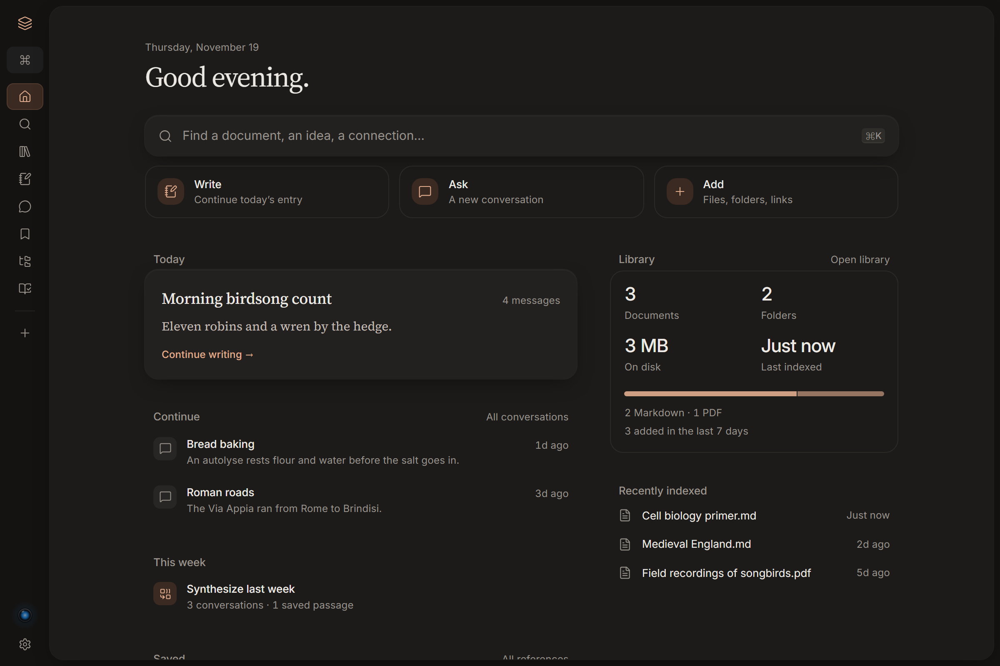
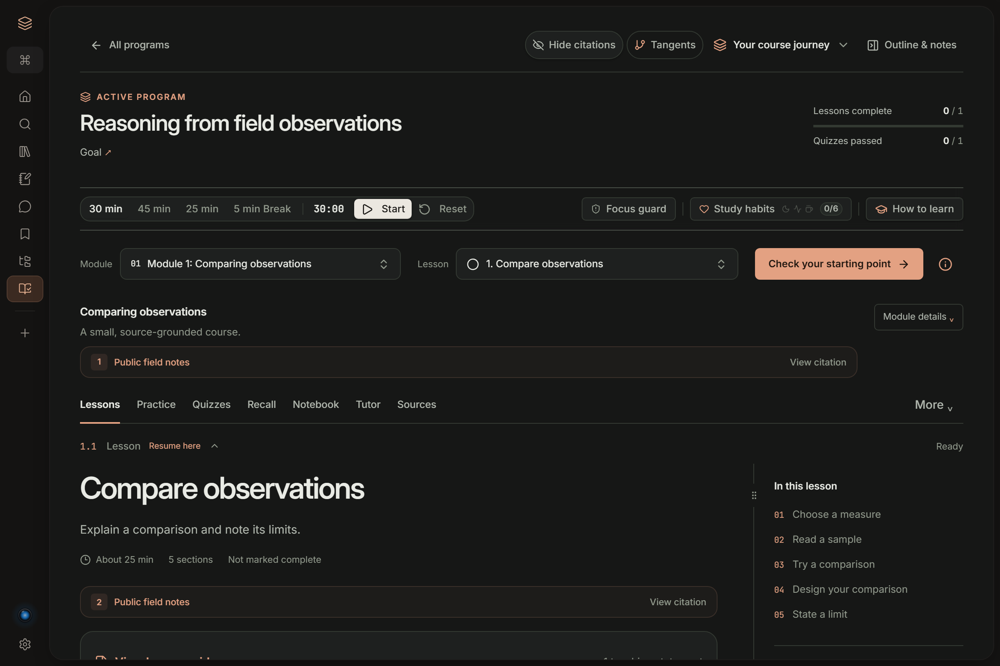
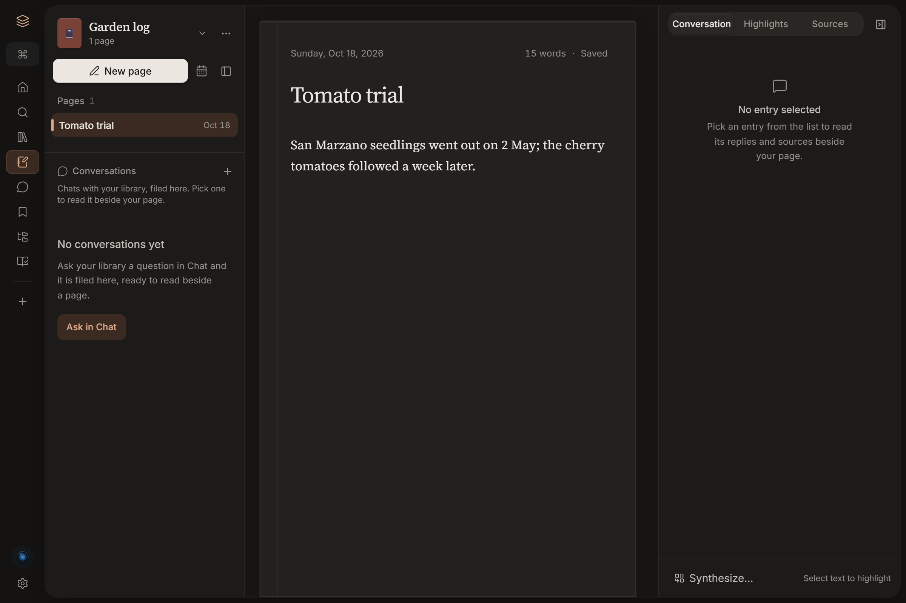
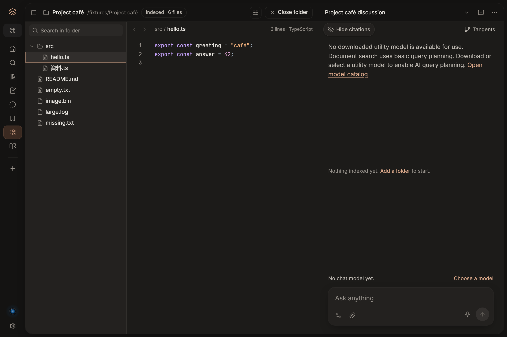

# Lattice

Lattice is a local-first desktop knowledge base and study studio. It indexes the files on your computer, searches them by keyword and by meaning, answers questions with clickable citations, and builds structured courses with lessons, exercises, quizzes, and flashcards.

Lattice needs no account or cloud subscription, and sends no product telemetry. Your library stays on your machine. If you choose a cloud AI provider (Anthropic Claude, OpenAI, or Google Gemini) or remote model server, only that turn's prompt and needed passages are sent to that provider; the [privacy FAQ](docs/user/faq.md#what-leaves-my-computer) lists every networked feature.

## Screenshots

Screenshots from the desktop app (dark theme). Click any image to view it at full size.

| Home dashboard | Learning Studio |
| --- | --- |
| [](docs/screenshots/dashboard.png) | [](docs/screenshots/studio.png) |
| **Journal** | **Explorer** |
| [](docs/screenshots/journal.png) | [](docs/screenshots/explorer.png) |

## Quickstart (zero experience required)

Works on **Windows 10/11 (x64)**, **macOS 13.3+ (Apple Silicon)**, and **Ubuntu 24.04 (x64)**.

### Step 1: Install Lattice

#### Option A — Download the installer (easiest)

Check [Releases](https://github.com/J-Reed700/lattice/releases) for the latest **Lattice app release** (look for `Lattice_<version>_...` files — ignore the `llama-server` sidecar releases).

| System | Installer file | How to install |
| --- | --- | --- |
| **Windows 10/11 (x64)** | `Lattice_<version>_x64-setup.exe` | Double-click the `.exe`. If Windows SmartScreen warns you, click **More info** → **Run anyway**. Then open **Lattice** from the Start menu. |
| **macOS (Apple Silicon)** | `Lattice_<version>_aarch64.dmg` | Open the `.dmg` and drag **Lattice** to **Applications**. On first launch, if macOS blocks it, open **System Settings → Privacy & Security** and click **Open Anyway**. |
| **Ubuntu 24.04 (x64)** | `Lattice_<version>_amd64.deb` | Run `sudo apt install ./Lattice_<version>_amd64.deb`, then open **Lattice** from your apps menu. |

> If there is no `Lattice_<version>` installer on the Releases page yet (or you want the very latest `main` build), use **Option B** below.

#### Option B — Build from this repository (Windows, macOS, or Linux)

If you cloned this repo (or clicked **Code → Download ZIP** and unzipped it), run the setup script inside the folder. It installs any missing prerequisites, builds Lattice, installs it, and opens it for you. Running it again later updates Lattice. *(First run takes ~10–15 minutes and needs ~8 GB of RAM/swap.)*

- **Windows 10/11:** Double-click **`setup.cmd`** in the repo folder (or run `powershell -ExecutionPolicy Bypass -File .\setup.ps1` in PowerShell from the repo folder).
- **macOS or Linux:** Open **Terminal** in the repo folder and run:

  ```bash
  ./setup.sh
  ```

---

### Step 2: Set up AI (first launch)

The first time you open Lattice, a **Set up AI** window appears. Pick **one** of these two paths:

#### Path A — Use an API key (Claude, OpenAI, or Google) — fastest, no downloads

1. Click **Use an API key instead**.
2. Choose your **Provider** (**Anthropic** for Claude is selected by default).
3. Paste your API key and click **Save key** (stored securely in your system keychain).
4. Pick a **Model** from the dropdown (for example, Claude Sonnet) and click **Use this model**.

Both **Chat** and **Learning Studio** courses now use that model immediately, with zero downloads.

> **Using your own PDFs or notes?** Choosing an API key skips local model downloads, so **chat and topic-based courses work right away**. If you later want to import PDFs, textbooks, or notes for semantic search or source-backed courses, open **Settings → AI → Models**, download an **embedding model**, and click **Set as Embedding** under **Downloaded**.

#### Path B — Run 100% locally and offline (no API key needed)

1. In the **Set up AI** window, pick one of the recommended chat models sized to your computer's memory (Lattice includes an embedding model automatically and shows the total download size).
2. Click **Install**. Downloads run in the background and activate automatically when finished.

You can switch providers or models any time under **Settings → AI → Chat** and **Settings → AI → Models**.

---

### Step 3: Start your first course (Learning Studio)

1. Click **Studio** in the left sidebar (`Ctrl+7` on Windows/Linux, `⌘7` on macOS).
2. Click **Build your first program** (or **Build a program** in the top right).
3. Under **Your goal**, describe what you want to learn (for example: *"Learn introductory statistics well enough to design an experiment and interpret results"*). Optionally add what you already know.
4. Pick a course depth (**Focused course**, **Complete course**, or **Deep dive**) and your preferred session length.
5. *(Optional)* Click **Add optional materials** to attach documents from your Library or paste reference URLs. If you skip this, Lattice researches and verifies supporting web references automatically.
6. Click **Create outline**. Generating and reviewing the outline takes a few minutes depending on your model and course depth — you can watch each step live.
7. Review the outline, approve it, and open **Lesson 1** to start studying.

---

### Step 4: Finding your way around

| Sidebar view | Windows / Linux | macOS | What it's for |
| --- | --- | --- | --- |
| **Home** | `Ctrl+0` | `⌘0` | Dashboard with quick search, today's journal, recent chats, and library stats |
| **Search** | `Ctrl+1` | `⌘1` | Hybrid keyword + meaning search across your indexed files |
| **Library** | `Ctrl+2` | `⌘2` | Browse and inspect every imported document |
| **Journal** | `Ctrl+3` | `⌘3` | Daily notes, writing pages, highlights, and conversation synthesis |
| **Chat** | `Ctrl+4` | `⌘4` | Ask questions against your library with clickable citations |
| **References** | `Ctrl+5` | `⌘5` | Saved passages and bookmarked answers |
| **Explorer** | `Ctrl+6` | `⌘6` | Open a local code/project folder beside a chat that reads the files |
| **Studio** | `Ctrl+7` | `⌘7` | Courses, lessons, practice sessions, quizzes, and spaced-repetition flashcards |
| **Import** | `Ctrl+I` | `⌘I` | Add PDFs, Word docs, Markdown, code files, audio, or web URLs |
| **Command palette** | `Ctrl+K` | `⌘K` | Jump anywhere or run any action |
| **Settings** | `Ctrl+,` | `⌘,` | AI providers, API keys, local models, theme, vault mirror, and logs |

See the [Getting Started Guide](docs/user/getting-started.md) and [User Manual](docs/user/user-manual.md) for full walkthroughs.

## What Lattice does

- **Learning Studio & Practice.** Build a course from a topic or your own materials: verified outlines, structured lessons, worked examples, exercises, quizzes, hands-on sandboxed labs, coaching/interview practice, and cited spaced-repetition flashcards.
- **Search that understands meaning.** Indexing runs locally: text is extracted, embedded on-device, and stored in SQLite, blending exact keywords with semantic vector similarity.
- **Chat with receipts.** Ask questions against your library and get answers with clickable footnoted citations that open the exact source passage beside the chat.
- **Voice, on-device.** Whisper transcribes speech and Kokoro reads answers and lessons aloud locally; imported audio becomes searchable timestamped transcripts.
- **Explorer & Journal.** Browse local folders alongside a code-aware chat, or write in a journal linked to your sources and conversations.

## Developer setup

### What the setup scripts install

| | Windows (`setup.ps1`, winget) | macOS (`setup.sh`) | Linux (`setup.sh`, apt/dnf) |
| --- | --- | --- | --- |
| Build tools | Visual Studio 2022 Build Tools (C++), Git, Python 3 | Xcode Command Line Tools | WebKitGTK 4.1, GTK, [Tauri prerequisites](https://v2.tauri.app/start/prerequisites/), C/C++ toolchain, git, curl, python3, Vulkan loader |
| Rust | rustup + toolchain pinned in `rust-toolchain.toml` | same | same |
| Node.js | Node.js LTS | Node 24 in `~/.local/share/lattice/toolchain` | same |
| Project | `npm ci` + pinned `llama-server` sidecar | same | same |
| App | NSIS installer (current user) | `Lattice.app` in `/Applications` | `.deb` or `.rpm` |

Script flags:
- **Windows:** `-Check` (report missing tools), `-Deps` (prerequisites only), `-Dev` (run `npm run tauri:dev`), `-Yes` (no prompts).
- **macOS / Linux:** `--check`, `--deps`, `--dev`, `--yes`. On Arch Linux, use `./setup.sh --dev`.

### Set up by hand

You'll need Node.js 20.19+ or 22.12+ (CI uses 24), `rustup` (`rust-toolchain.toml` pins the Rust version), and the [Tauri prerequisites](https://v2.tauri.app/start/prerequisites/) for your OS. Local generation requires the bundled `llama-server` sidecar (see [crates/lattice-desktop/binaries](crates/lattice-desktop/binaries/README.md)).

```bash
npm ci
bash crates/lattice-desktop/scripts/fetch-llama-binaries.sh
npm run tauri:dev
```

The frontend can run on its own with `npx vite` (port 5173), but anything that talks to the Rust backend needs the Tauri dev process.

### Repository layout

```text
.
├── crates/
│   ├── lattice-core/      # Domain, application ports and contracts; no Tauri
│   ├── lattice-desktop/   # The Tauri app: features, infrastructure, commands,
│   │                      # migrations, sidecar binaries and app configuration
│   ├── lattice-index/     # Passage and vector indexes
│   ├── lattice-learning/  # Learning Studio's engine; its plugin stays in the app
│   ├── lattice-store/     # Workspace notes
│   ├── lattice-sync/      # Experimental sync service (its own workspace)
│   └── vendor/            # Vendored third-party crates, outside the workspace
├── src/                   # React and TypeScript frontend
├── e2e/                   # Playwright renderer journeys and native desktop tests
├── evals/                 # Retrieval, grounding and memory eval sets and results
├── docs/                  # Architecture, ADRs, design docs and user docs
├── scripts/               # Repository checks and developer utilities
└── Cargo.toml             # Rust workspace: every crate above except lattice-sync
```

See [Rust architecture](docs/RUST_ARCHITECTURE.md), [platform support](docs/development/platform-support.md), and [CONTRIBUTING.md](CONTRIBUTING.md) for architecture rules and checks.

### Development checks

Frontend:

```bash
npm run type-check
npm run type-check:e2e
npm run lint
npm run contracts:check
npm test -- --run
npx vite build && node scripts/check-initial-js-budget.mjs dist
```

Production renderer smoke tests (Chromium and WebKit, simulated desktop IPC):

```bash
npx playwright install --with-deps chromium webkit
npm run test:e2e
```

Desktop backend (run from `crates/lattice-desktop`):

```bash
cd crates/lattice-desktop
cargo fmt --all -- --check
cargo clippy --workspace --all-targets -- -D warnings
cargo test --workspace --lib
```

Architecture and contract checks:

```bash
cargo test --locked --manifest-path scripts/rust-architecture-check/Cargo.toml
cargo test --locked --manifest-path scripts/data-contract-check/Cargo.toml
bash scripts/check-repository-barrier.sh
bash scripts/check-rust-layer-boundaries.sh
python3 scripts/check-sql-contracts.py
python3 scripts/check-tauri-command-inventory.py
```

### Publishing a release

In GitHub, open **Actions → Release → Run workflow** on `main`. It builds the Windows, macOS, and Ubuntu installers and creates a draft release. Verify the installer files, then publish it with **"Set as the latest release"** checked.

## License

Lattice is available under the [MIT License](LICENSE).
