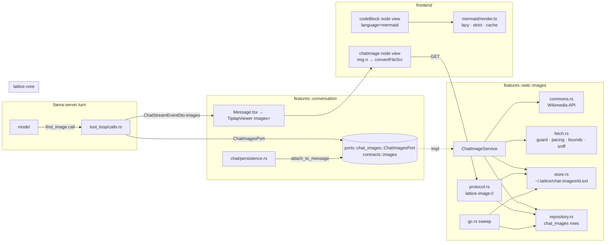

# Chat images and diagrams

Status: design, 2026-10-17. Branch `feat/chat-images-diagrams` off `main` 32c379c4. Builds as two PRs (§12): diagrams first (frontend only), web pictures second.

## 0. The ask, and the answer in one paragraph

An assistant answer should be able to show, between its paragraphs, (1) a diagram the model drew and (2) a real picture of the thing being discussed. Diagrams are a ```` ```mermaid ```` fence that the chat viewer renders to SVG in place — a Tiptap node view on the existing code block, Mermaid loaded lazily, `securityLevel: 'strict'`, coloured from the app's CSS tokens, rendered only once the fence is closed and memoised by source so streaming never re-runs Mermaid. Pictures come through one new tool, `find_image`, which searches Wikimedia Commons (or takes the lead image of a page read this turn), downloads the bytes under the web feature's existing address guard and pacing, validates them by magic bytes, stores them as a verified file beside the frozen web snapshots, and hands the model a stable reference (`img-1`) to paste as ``. The stored file is served to the main webview only, through a second private URL scheme (`lattice-image`) built exactly like `lattice-snapshot`, so no remote image is ever loaded by the webview: the CSP keeps forbidding every remote `img-src`, and the node view refuses any image whose address is not one of the message's own references. A picture is a row leased by its turn, attached to its message when the answer is persisted, released when the message or conversation is deleted, swept at startup, exported beside the Markdown, and backed up with everything else. Images and diagrams are not claims: the grounding check skips them, the caption carries the source's citation chip, and summaries see `[Picture: caption]`. Diffusion-style generation is out of scope.

## 1. What exists today

- Answers render through `src/components/TiptapEditor/TiptapViewer.tsx` (tiptap-markdown, `html: false`) from `src/features/chat/components/Message.tsx:294`, after `normalizeAssistantMarkdown` (`src/utils/assistantMarkdown.ts`, which already tracks code fences line by line). Extensions are shared with the notes editor in `src/components/TiptapEditor/extensions/index.ts`: `CodeBlockLowlight` (`defaultLanguage: 'plaintext'`), `Image.configure({ inline: true, allowBase64: true })`, `Link`, `CitationMarks`, `ClaimMarks`, `CodeRefMarks`. No Mermaid dependency. `dompurify ^3.3`, `katex`, `lowlight` are already dependencies; `vitest` 4 with jsdom (`vitest.config.ts`).
- App CSP (`crates/lattice-desktop/tauri.conf.json:31`): `img-src 'self' data: asset: http://asset.localhost`, `script-src 'self'`, `style-src 'self' 'unsafe-inline'`, `frame-src lattice-snapshot: http://lattice-snapshot.localhost`. Remote images are blocked and stay blocked.
- Frozen web snapshots (PR #51, `docs/design/2026-10-13-frozen-web-snapshots.md`): `crates/lattice-desktop/src/features/web/snapshots/{store,repository,protocol,gc,dto,commands,job}.rs`. `SnapshotStore` writes `~/.lattice/web-snapshots/<id>.html` atomically (0600, `.part` then rename, SHA-256 returned), `protocol::respond` checks `webview_label == "main"`, looks the row up, verifies the hash on every read (`Verified::{Intact,Mismatch,Missing}`), answers with a locked CSP. `main.rs:32` registers the scheme with `register_asynchronous_uri_scheme_protocol` and a commented `raw-spawn`. `WebSnapshotGc::sweep` removes `.part` files older than an hour and `.html` files no live row claims. The backup archives the folder beside the web archive (`backup/archive/format.rs::web_snapshots_root_beside`, `payload.rs` step 4b, `extract.rs`). The frontend builds frame URLs with `convertFileSrc(path, 'lattice-snapshot')` (`src/features/reading/snapshot/snapshotFrameUrl.ts`).
- Web client: `features/web/services/web.rs` (`WebService { client, pacer: SitePacer, page_cache, … }`, built by `build_public_client` with stealth headers from `services/stealth.rs`), `services/web/address_guard.rs` (private-address guard on URL, redirects and resolver), `services/web/page.rs::read_bounded_body` (byte-bounded body reader), `services/web/pacing.rs::SitePacer` (per-site interval). `services/capture.rs:160` already extracts `og:image` / `twitter:image`. `function_calling/executor.rs` keeps a plain `reqwest::Client` plus `WIKIPEDIA_USER_AGENT` (`lattice/<version>`) for the Wikipedia API.
- Tools. Vocabulary (inputs/outputs) lives in `lattice-core/src/application/contracts/tools/{dto,calls}.rs` (`ToolDefinition`, `FunctionResult::{success,error}`, `FetchUrlContentInput`, …) and `contracts/web.rs` (`WebSearchOutput`, `FetchUrlContentOutput`). Definitions the model sees are registered in `features/function_calling/registry.rs::init_function_registry` (JSON schemas inline). Execution: `function_calling/executor/{dispatch,web_tools,…}.rs`. The chat loop (`features/conversation/chat/tool_loop/calls.rs`) intercepts some tools before the executor (`history_tools::is_history_tool` at ~500; `fetch_url_content` archive hit at ~521) and records results as sources through `tool_sources.rs::collect_tool_sources`. Which tools a turn offers: `chat/tools.rs` (`OPTIONAL_BUILTIN_TOOL_NAMES`, `build_optional_tool_allowlist`), gated by `ToolPreferences.web_search` / `enabled_tools`; `runs_alongside_others` in `calls.rs:70` lists read-only tools; `call_labels.rs::tool_step_kind` maps a tool to a `TurnStepKind` (`turn_record.rs:39`), mirrored by the zod enum in `src/types/conversation.ts:462` and `src/features/chat/components/turn/research.ts` (`WEB_KINDS`).
- Ports between conversation and the rest: `chat/ports.rs` (`ChatRuntime`, `ChatRecords`, `ChatTools`, `PageReader`, …) implemented on the composition root `interfaces::di::Container` in `features/conversation/di/chat_runtime.rs`. The architecture ratchet (`scripts/rust-architecture-check/baseline.txt`) has `feature-edge features::conversation features::web 2` and `features::function_calling features::web 1`; neither may grow, so every new crossing goes through a lattice-core port or the Container.
- Messages: `conversation_messages(id, conversation_id, role, content, metadata TEXT, status, sequence, …)`; the answer's sources are `metadata.sources` (`chat/persistence.rs:123`), later patched by `source_snapshots/capture.rs:132`; the frontend parses them in `src/features/chat/controller/messageMetadata.ts`. Streaming events are `ChatStreamEventDto` (`chat/dto.rs:151`) with optional `step`, `verification`, `captured` fields.
- Lifecycle elsewhere: library blobs use `ContentAddressedStoragePort` + `LibraryGc` (`features/indexing/library_gc.rs`), whose reference check is `documents.checksum` — a document concept, not a message one (see §13 for why images do not go there). Message delete: `plugin_impl.rs:315 delete_conversation_message_impl`; conversation delete: `plugin_impl.rs:128`. Memory folding reads `message.content` (`conversation/memory/summarize.rs::plan_fold`), as do handoff (`conversation/handoff.rs::transcript_passages`) and Markdown export (`backup/use_cases/export_conversations.rs::write_markdown`). Grounding: `chat/verification/lexical.rs::sentences_with_citations` splits the answer by line and sentence and keeps sentences carrying `[n]`.
- Vision: the chat sidecar is started without a projector. `--mmproj` appears only for the OCR engine (`lattice-core/src/domain/models/curated/ocr.rs`, `ports/ocr_port.rs`: "a separate process … because `--mmproj` cannot" be shared). No chat request carries image parts. See §9.

## 2. Goals and non-goals

Goals

- G1. A ```` ```mermaid ```` fence in an assistant answer is drawn as an SVG in place, in both themes, in the chat viewer and anywhere else `TiptapViewer` renders Markdown (lessons use it too: 7 files under `src/features/learning`).
- G2. The model can obtain a real picture of a concrete subject and place it inline with a caption; the picture is stored locally, cited to its source page, and opens larger on click.
- G3. The webview never requests a remote image. The CSP stays closed to remote `img-src`; the viewer renders only references the backend stored.
- G4. A stored picture lives and dies with its message: leased by the turn, attached on persist, released on delete, swept at startup, exported and backed up.
- G5. Nothing is a claim that is not prose: diagrams and pictures are skipped by the grounding check and never carry claim marks.
- G6. A 9B local model uses both features only when they help and never invents an image address.

Non-goals

- Image generation (diffusion), image editing, user-uploaded pictures in the composer (attachments already exist and are a different path).
- Rendering remote or `data:` images the model writes by hand. They show a placeholder.
- Vision relevance checks (§9): the sidecar has no projector.
- Mermaid interactivity (click callbacks, zoom-pan inside the message), Mermaid in the editable notes editor beyond what falls out of the shared extension list (the editor keeps the plain code block, §6.1).
- Thumbnails in the research deck card (follow-up, §15).

## 3. User-visible behaviour

Diagrams

- While an answer streams, a mermaid fence shows as an ordinary code block with its source. The moment the closing fence arrives, the block becomes the drawn diagram; later chunks of the same answer do not redraw it.
- The diagram sits in a bordered figure using the code-block surface, centred, at most the column width; tall diagrams keep their aspect ratio. A small `Diagram` label and a `Source` toggle sit in the figure header; `Source` flips to the fenced code (highlighted by lowlight as today). Click or `Enlarge` opens the lightbox (§6.6) scaled to the window; `Esc` closes.
- Theme switch recolours every visible diagram without reloading.
- If Mermaid cannot parse the source, the code block stays and a muted line under it says `Diagram could not be drawn: <Mermaid's message>`.

Pictures

- The turn record shows a step `Finding a picture of <query>` → `1 picture from Wikimedia Commons`, with the source page as a link, like a search step.
- The answer shows a figure: the image (lazy-loaded, intrinsic aspect ratio from stored width/height so the layout never jumps), under it the caption in the citation footnote style, followed by the source's citation chip `[n]` (same numbering as the other sources of that answer) and, when known, `CC BY-SA 4.0 · <artist>`. Click opens the lightbox with the caption, licence and `Open source page`.
- A reference that did not resolve (the model mistyped `img-3`, or a stored file failed its hash) shows a placeholder figure: `Picture not available` plus the alt text. Any other image address the model writes (`https://…`, `data:`) shows `External images are not shown here`, and nothing is fetched.
- Deleting the message or the conversation removes its pictures from disk. Export to Markdown writes them to an `images/` folder beside the file. Backups contain them. "Continue in new chat" carries `[Picture: caption]` in the summary, not the file.

## 4. Architecture



Two independent mechanisms share one viewer. Diagrams never leave the frontend. Pictures cross exactly one feature boundary, through a core port implemented in `features::web::images` and exposed on the `Container`, so the conversation feature keeps its two baselined references to `features::web` and gains none.

## 5. Threat model and security bounds

| # | Threat | Where it is stopped |
|---|--------|---------------------|
| T1 | Model-written image URL leaks the user's IP per render, or points at a private address | CSP `img-src` has no remote scheme; the node view renders only `img-N` refs present in the message's stored list; everything else is a placeholder and no request is made. |
| T2 | Fetching the picture reaches the LAN / loopback / metadata endpoints | `features/web/services/web/address_guard.rs` on the URL, on every redirect hop, and in the resolver — the same client `WebService` uses. `https` only. |
| T3 | Decode bomb / oversize download exhausts the webview | **Security bounds, not content caps:** body read with `read_bounded_body(MAX_IMAGE_BYTES = 20 MiB)` (a Commons thumbnail at 1280 px is well under 1 MiB; the bound exists because the webview decodes whatever is served and a 20 MiB JPEG can expand to gigabytes); header-only dimension check (`imagesize`) rejects more than 50 megapixels for the same reason. |
| T4 | Script-bearing formats (SVG with `<script>`, HTML served as an image) | Magic-byte sniff with `infer`; only `image/jpeg`, `image/png`, `image/gif`, `image/webp` are stored. SVG is rejected, not rasterised (see §13). The `Content-Type` header is never trusted. Served with `X-Content-Type-Options: nosniff` and the sniffed type. |
| T5 | File swapped on disk after storage | Row holds `sha256`; `protocol.rs` serves only `Verified::Intact` bytes, else 409 and the viewer shows the placeholder. |
| T6 | Another webview or page reads stored pictures | Scheme handler answers only `webview_label == "main"` (same as snapshots). File names are 32-hex ids validated before any path is built. |
| T7 | Mermaid source executes script or styles the page | `securityLevel: 'strict'` (labels sanitised, no click bindings; the `secure` config keys cannot be changed by `%%{init}%%` directives), `htmlLabels: false` so labels are SVG text not `foreignObject` HTML, the SVG string passed through DOMPurify's SVG profile before `innerHTML`, and the figure's CSS scopes `svg` size. No `unsafe-eval` is needed: Mermaid 11 is plain ESM, bundled by Vite and served from `'self'`; it emits one `<style>` element and inline `style=""` attributes, which `style-src 'unsafe-inline'` already allows. |
| T8 | Pathological diagram burns the renderer | Mermaid's own `maxTextSize` (50 000 chars) and `maxEdges` (500) stay at defaults — render time is superlinear in both; they are bounds on a hostile input, not on content. Rendering runs off the React commit (`await` in an effect), one diagram at a time through a small queue so ids never collide. |
| T9 | A stored picture outlives its message | Rows `ON DELETE CASCADE` from both `conversations` and `conversation_messages`; delete paths release files first; the startup sweep removes files no row claims and rows no message claims (§7.6). |

## 6. Diagrams (PR 1, frontend only)

### 6.1 Where a mermaid fence goes

tiptap-markdown turns every fence into the existing `codeBlock` node with `attrs.language`. Rather than a second node type with its own markdown-it token plumbing, the code block gets a React node view and decides per node:

- `src/components/TiptapEditor/extensions/codeBlockView.tsx` — `CodeBlockLowlight.extend({ addNodeView() { return ReactNodeViewRenderer(CodeBlockView) } })`, exported as `CodeBlockWithDiagrams`. `index.ts` registers it in place of `CodeBlockLowlight.configure(...)` (same `lowlight`, same `defaultLanguage`).
- `CodeBlockView` renders `<NodeViewWrapper as="pre" className="tiptap-code-block"><NodeViewContent as="code" /></NodeViewWrapper>` for every language — lowlight's decorations still apply inside `NodeViewContent` — and, when `node.attrs.language === 'mermaid'` **and** `!editor.isEditable`, wraps that in `<MermaidFigure source={node.textContent} …>` which shows the diagram and keeps the `<pre>` as the `Source` view. Editable editors (notes) are untouched: plain code block, no Mermaid.
- `ExtensionConfig` gains `diagrams?: boolean` (default `true`); `TiptapViewer` passes it through; a future caller can turn it off.

### 6.2 Renderer module

`src/components/TiptapEditor/mermaid/render.ts`:

- `loadMermaid()` — `await import('mermaid')` once (Vite chunk; the initial-bundle budget check `scripts/check-initial-js-budget.mjs` must not move). Calls `mermaid.initialize({ startOnLoad: false, securityLevel: 'strict', theme: 'base', themeVariables: themeVariablesFromTokens(), fontFamily: tokenFont(), flowchart: { htmlLabels: false }, sequence: { useMaxWidth: true }, suppressErrorRendering: true })`. Re-initialised when the theme epoch changes.
- `themeVariablesFromTokens()` reads `getComputedStyle(document.documentElement)` for `--surface`, `--surface-raised`, `--surface-sunken`, `--border-default`, `--border-strong`, `--text-primary`, `--text-secondary`, `--accent`, `--accent-muted` (all `H S% L%` triples, `src/index.css:134`), converts each to a hex string (`hslTripleToHex`), and maps: `background` ← surface, `primaryColor` ← accent-muted, `primaryBorderColor` ← border-strong, `primaryTextColor` ← text-primary, `secondaryColor` ← surface-raised, `tertiaryColor` ← surface-sunken, `lineColor` ← text-secondary, `textColor` ← text-primary, `noteBkgColor` ← surface-raised, `noteTextColor` ← text-primary, `fontFamily` ← the app serif/sans token used by `.chat-answer`. Mermaid derives the rest of its palette from these.
- `renderMermaid(source, themeEpoch): Promise<RenderResult>` where `RenderResult = { kind: 'svg', svg: string } | { kind: 'error', message: string }`. Steps: `await mermaid.parse(source)` inside try/catch (an error becomes `kind: 'error'` with the message); `const { svg } = await mermaid.render('lattice-mermaid-' + counter, source)`; `DOMPurify.sanitize(svg, { USE_PROFILES: { svg: true, svgFilters: true }, ADD_TAGS: ['style'], FORBID_TAGS: ['script', 'foreignObject'], FORBID_ATTR: ['onload', 'onclick'] })`. Calls are serialised through one promise chain.
- Cache: `Map<string, Promise<RenderResult>>` keyed by `${themeEpoch}\n${source}`, bounded to 200 entries (least-recently-inserted evicted; a memory bound, since each entry is an SVG string). Re-mounts during streaming hit the cache and cost one `innerHTML`.
- Theme epoch: `src/components/TiptapEditor/mermaid/themeEpoch.ts` — a `MutationObserver` on `document.documentElement` for `data-theme` / `class` (set by `src/hooks/useApplyTheme.ts`), exposed as `useThemeEpoch()` via `useSyncExternalStore`. `MermaidFigure` re-renders when it changes; the cache key makes the old SVG unreachable.

### 6.3 Streaming

An unclosed fence at the end of a streaming answer parses as a code block running to the end of the document. The viewer must not render that:

- `src/utils/assistantMarkdown.ts` exports `hasUnclosedFence(content): boolean` (the fence-tracking loop already exists; lift the toggle into a helper both use).
- `TiptapViewer` gains `streaming?: boolean`; `Message.tsx` passes `isPending`. The viewer computes `suspendLastBlock = streaming && hasUnclosedFence(content)` and stores it in `editor.storage.diagrams.suspendLastBlock` (a tiny `Extension.create({ name: 'diagrams', addStorage })` in `codeBlockView.tsx`), updating via a ref the same way `citationNumbersRef` is handled.
- `CodeBlockView` renders the diagram only when `!(suspendLastBlock && isLastBlock(node))`; otherwise it shows the code. `isLastBlock` compares `getPos() + node.nodeSize === editor.state.doc.content.size`.
- Because the cache key is the source, a closed fence followed by more streaming text renders once and stays.

### 6.4 Errors

`kind: 'error'` → the figure shows the `<pre>` (code visible, lowlight highlighted) and a `<p class="diagram-error">` with `Diagram could not be drawn: <message>`; the `Source` toggle is hidden because the source is already showing. Mermaid's own error SVG is never inserted (`suppressErrorRendering: true`).

### 6.5 CSP and dependencies

No change to `tauri.conf.json` for diagrams (§5 T7). Dependency: `mermaid` 11.x, latest stable at install time, **pinned exactly** in `package.json` (no caret — this code runs on model-written input and upgrades must be deliberate); `package-lock.json` updated by `npm install`. Nothing else new; DOMPurify is already present.

### 6.6 Lightbox

`src/components/MediaLightbox.tsx` — one component shared by diagrams (PR 1) and pictures (PR 2): a `<dialog>`-based overlay (`role="dialog"`, focus trapped, `Esc` and backdrop close, focus returned via `src/lib/focusReturn.ts`), content slot centred and scaled to `min(90vw, 90vh)`, optional caption and action row. Styles use `--surface-overlay`, `--border-subtle`, `--shadow-*`, `--radius-*` tokens; dark theme falls out of the tokens.

### 6.7 Marks must skip code

`CitationMarks` (`/\[(\d{1,5})\]/`), `ClaimMarks` and `CodeRefMarks` decorate by text search. A mermaid label `A[1] --> B[2]` would get citation chips. PR 1 adds a test in `src/components/TiptapEditor/__tests__/marksSkipCode.test.ts` that no decoration lands inside a `codeBlock` node, and fixes the extensions that fail it by skipping `codeBlock` descendants in their `doc.descendants` walk.

### 6.8 Styles

`src/components/TiptapEditor/tiptap.css` section 5 (code blocks) gains `.tiptap-viewer .diagram-figure` (surface + `--border-subtle` + `--radius-md`, like `pre`), `.diagram-header` (muted label, `Source` / `Enlarge` text buttons in `--text-tertiary` hover `--text-secondary`), `.diagram-svg svg { max-width: 100%; height: auto; }`, `.diagram-error` (`--text-secondary`, small). Both themes come from the tokens; verify with the UI rig (§10).

## 7. Pictures (PR 2)

### 7.1 The tool the model sees

Registered in `features/function_calling/registry.rs::init_function_registry` (name constant `TOOL_FIND_IMAGE` in `executor.rs` for symmetry):

```json
{
  "name": "find_image",
  "description": "Find a real photograph or illustration of a concrete subject (an object, place, organism, person, artwork, machine, event) when seeing it would genuinely help the reader. Searches Wikimedia Commons, or takes the main picture of a page you read this turn when from_page_url is given. Each result is already stored; place one by pasting its `markdown` line as its own paragraph, unchanged. Never write an image address yourself: only `markdown` lines from this result display.",
  "input_schema": {
    "type": "object",
    "properties": {
      "query": { "type": "string", "description": "What the picture should show, 2-6 words, e.g. 'Saturn V rocket launch'" },
      "from_page_url": { "type": "string", "description": "A page read this turn whose main picture you want instead of a search" },
      "limit": { "type": "integer", "minimum": 1, "maximum": 6, "description": "How many candidates to return (default 3)" }
    },
    "required": ["query"]
  }
}
```

Result (`FunctionResult::success(FindImageOutput)`), rendered to the model as JSON:

```json
{
  "images": [
    { "ref": "img-1", "caption": "Saturn V SA-506 lifting off with Apollo 11, 16 July 1969", "source_title": "File:Apollo 11 Launch - GPN-2000-000630.jpg", "source_url": "https://commons.wikimedia.org/wiki/File:Apollo_11_Launch_-_GPN-2000-000630.jpg", "license": "Public domain", "width": 1280, "height": 1600, "markdown": "" }
  ],
  "note": "Paste one markdown line as its own paragraph. Do not add a citation to it; the app cites the source."
}
```

Refs are numbered per turn across calls (`img-1`, `img-2`, … by counting the request's existing rows), so two `find_image` calls in one turn never collide. An empty result returns `images: []` and `note: "No suitable picture found. Answer without one."` (success, not error — the model should move on).

### 7.2 Core contracts and port

`lattice-core/src/application/contracts/images.rs` (new; `pub mod images;` in `contracts/mod.rs`):

```rust
#[derive(Debug, Clone, Serialize, Deserialize)]
pub struct FindImageInput {
    pub query: String,
    #[serde(default)] pub from_page_url: Option<String>,
    #[serde(default = "default_image_limit")] pub limit: usize, // clamp 1..=6, default 3
}

#[derive(Debug, Clone, Serialize, Deserialize)]
pub struct FoundImage {           // model-facing
    pub r#ref: String, pub caption: String, pub source_title: Option<String>,
    pub source_url: String, pub license: Option<String>,
    pub width: u32, pub height: u32, pub markdown: String,
}

#[derive(Debug, Clone, Serialize, Deserialize, Default)]
pub struct FindImageOutput { pub images: Vec<FoundImage>, pub note: Option<String> }

#[derive(Debug, Clone, Copy, PartialEq, Eq, Serialize, Deserialize, specta::Type)]
#[serde(rename_all = "snake_case")]
pub enum ImageOrigin { WikimediaCommons, Page }

/// What the window needs to show a stored picture. Travels in the stream
/// event and in `metadata.images`; the bytes travel over `lattice-image`.
#[derive(Debug, Clone, PartialEq, Serialize, Deserialize, specta::Type)]
#[serde(rename_all = "camelCase")]
pub struct ChatImageDto {
    pub id: String,            // 32 lowercase hex, the file stem
    pub r#ref: String,         // "img-1" as written in the answer
    pub file_name: String,     // "<id>.jpg" — what the frontend hands convertFileSrc
    pub mime: String,
    pub width: u32, pub height: u32, pub byte_size: u64,
    pub caption: String,
    pub source_url: String, pub source_title: Option<String>,
    pub origin: ImageOrigin,
    pub license: Option<String>, pub attribution: Option<String>,
}
```

`lattice-core/src/application/ports/chat_images.rs` (new; re-exported from `ports/mod.rs`):

```rust
pub struct ImageTurnScope { pub conversation_id: String, pub request_id: String }

#[async_trait]
pub trait ChatImagesPort: Send + Sync {
    /// Search, fetch, validate and store up to `input.limit` pictures for this
    /// turn. Network work stops at `deadline` (the turn's own, never a fixed
    /// timeout). Returns what the model sees and what the window sees.
    async fn find_and_store(&self, scope: &ImageTurnScope, input: FindImageInput,
                            deadline: Option<std::time::Instant>) -> Result<(FindImageOutput, Vec<ChatImageDto>)>;
    /// Attach the request's rows whose ref is in `referenced_refs` to the
    /// persisted message; release the rest. Returns the attached list.
    async fn attach_to_message(&self, request_id: &str, message_id: &str,
                               referenced_refs: &[String]) -> Result<Vec<ChatImageDto>>;
    /// A turn that failed or was stopped before persisting its answer.
    async fn release_request(&self, request_id: &str) -> Result<()>;
    async fn release_message(&self, message_id: &str) -> Result<()>;
    async fn release_conversation(&self, conversation_id: &str) -> Result<()>;
    async fn list_for_message(&self, message_id: &str) -> Result<Vec<ChatImageDto>>;
}
```

`lattice-core/src/shared/markdown_media.rs` (new): `image_refs(markdown) -> Vec<String>` (the `img-N` targets of ``), `images_to_captions(markdown) -> String` (replaces each with `[Picture: alt]`), `strip_fences_and_images(markdown) -> String` (for the grounding check). Pure functions, unit-tested.

### 7.3 Finding candidates

`features/web/images/commons.rs` — Wikimedia Commons, keyless:

```
GET https://commons.wikimedia.org/w/api.php?action=query&format=json&formatversion=2
    &generator=search&gsrnamespace=6&gsrlimit=<limit*2>&gsrsearch=filetype:bitmap <query>
    &prop=imageinfo&iiprop=url|size|mime|extmetadata&iiurlwidth=1280
    &iiextmetadatafilter=ImageDescription|LicenseShortName|Artist|Credit
```

Request with the descriptive `WIKIPEDIA_USER_AGENT` (Wikimedia's API policy wants an identifying agent; the existing Wikipedia tool already does this) through the same `reqwest::Client` the executor uses for Wikipedia (`FunctionExecutor.http_client` is private to function_calling; the images module builds its own `Client` with the same UA in `ChatImageService::new`). Candidate = one page with `imageinfo[0]`: `thumburl` (falls back to `url` when the original is already ≤ 1280 wide), `thumbwidth/thumbheight`, `mime`, `descriptionurl` → `source_url`, title → `source_title`, `extmetadata.ImageDescription.value` (HTML; strip tags, collapse whitespace) → caption, `LicenseShortName` → license, `Artist` (stripped) → attribution. Skip candidates whose `mime` is not in the allowed set before fetching. Take candidates in API order until `limit` are stored or none are left.

`from_page_url`: read the page with `WebService::read_page(url)` (served from the page cache when the turn already read it — no second network read for a page fetched this turn), extract `og:image` / `twitter:image` with the same meta-tag logic as `services/capture.rs:160` (lift `extract_og_tag`/`extract_meta_tag` into a small shared helper in `services/capture.rs` or call the existing `extract_metadata`), fall back to the first `` inside `<article>`/`<main>` with both `width` and `height` ≥ 300 if present. Caption = page title; `source_url` = the page; `origin = Page`; no licence.

### 7.4 Fetch and validation

`features/web/images/fetch.rs` — `pub async fn fetch_image(web: &WebService, url: &str, deadline: Option<Instant>) -> Result<FetchedImage, ImageRejected>`:

1. `parse_fetchable_url` + `address_guard` check (reuse `WebService`'s client, which already carries the guard in its resolver and redirect policy; `https` only, else `ImageRejected::Scheme`).
2. `web.pacer.acquire(url)` so a burst of Commons downloads obeys the site interval; the request runs with `tokio::time::timeout_at(deadline)` when a deadline is given — the only clock involved is the turn's.
3. `read_bounded_body(response, MAX_IMAGE_BYTES)`; over the bound → `ImageRejected::TooLarge`.
4. `infer::get(&bytes)` → mime must be one of `image/jpeg | image/png | image/gif | image/webp`, else `ImageRejected::Format(sniffed)`; `imagesize::blob_size(&bytes)` → width/height; `width * height > MAX_IMAGE_PIXELS` → `ImageRejected::TooManyPixels`.
5. Return `FetchedImage { bytes, mime, width, height, sha256 }`.

`WebService` gains `pub(crate) fn client(&self) -> &reqwest::Client` and `pub(crate) fn pacer(&self) -> &SitePacer` (or a `pub async fn fetch_bytes_bounded(&self, url, max_bytes, deadline)`) so the images module stays inside `features::web` and reuses the guarded client instead of building a second one. New dependency: `imagesize` (header-only dimension reader; no decoding) in `crates/lattice-desktop/Cargo.toml`. `infer`, `sha2`, `hex` already exist.

### 7.5 Storage, rows, migration

`features/web/images/store.rs` — `ImageStore`, a copy of `snapshots/store.rs` with the extension carried: root `~/.lattice/chat-images` (`lattice_core::shared::fs::roots::chat_images_root()`, new, beside `web_snapshots_root`), `path_for(id, ext)` only for a valid 32-hex id and an ext in `{jpg,png,gif,webp}`, atomic `.part` write, 0600, returns `(sha256, size)`, `read_verified(id, ext, expected)`, `remove`.

Migration `crates/lattice-desktop/migrations/20261017120000_chat_images.sql` (new file; nothing shipped is edited; no table rebuild):

```sql
-- Pictures an assistant answer shows inline. The file lives at
-- ~/.lattice/chat-images/<id>.<ext>; sha256 is checked on every read.
-- message_id is NULL while the turn that fetched the picture is still running;
-- the row is then leased by request_id and attached when the answer persists.
-- Design: docs/design/2026-10-17-chat-images-and-diagrams.md §7.5–7.6.
CREATE TABLE chat_images (
    id TEXT PRIMARY KEY,
    conversation_id TEXT NOT NULL REFERENCES conversations(id) ON DELETE CASCADE,
    request_id TEXT NOT NULL,
    message_id TEXT REFERENCES conversation_messages(id) ON DELETE CASCADE,
    ref TEXT NOT NULL,
    ext TEXT NOT NULL CHECK (ext IN ('jpg','png','gif','webp')),
    mime TEXT NOT NULL,
    sha256 TEXT NOT NULL,
    byte_size INTEGER NOT NULL,
    width INTEGER NOT NULL,
    height INTEGER NOT NULL,
    caption TEXT NOT NULL,
    source_url TEXT NOT NULL,
    source_title TEXT,
    image_url TEXT NOT NULL,
    origin TEXT NOT NULL CHECK (origin IN ('wikimedia_commons','page')),
    license TEXT,
    attribution TEXT,
    created_at TEXT NOT NULL,
    UNIQUE (request_id, ref)
);
CREATE INDEX idx_chat_images_message ON chat_images(message_id);
CREATE INDEX idx_chat_images_conversation ON chat_images(conversation_id);
CREATE INDEX idx_chat_images_request ON chat_images(request_id);
```

`features/web/images/repository.rs` — `ImageRepository { pool }`: `insert(NewImageRow)`, `next_ref(request_id) -> u32`, `get(id) -> Option<ImageRow>`, `attach(request_id, message_id, refs) -> Vec<ImageRow>` and `unattached(request_id, not_in_refs) -> Vec<ImageRow>` (so the service can delete those files), `for_message`, `for_conversation`, `delete_ids`, `live_files() -> HashSet<(id, ext)>`, `orphans_without_message() -> Vec<ImageRow>` (rows with NULL `message_id`, used only by the startup sweep — a running turn cannot survive a restart, so no age bound is needed and none is used).

### 7.6 Lease lifecycle

| Moment | What happens | Where |
|---|---|---|
| `find_image` succeeds | File written, row inserted with `message_id NULL` — the request holds the lease | `ChatImageService::find_and_store` |
| Answer persisted | `attach_to_message(request_id, message_id, image_refs(content))`: referenced rows get `message_id`; unreferenced rows and files are removed; the attached DTOs are written to `metadata.images` | `chat/persistence.rs` beside the `sources` insert (~line 123), through `scope.container.chat_images()` |
| Turn fails / Stop before persist | `release_request(request_id)` from the turn's failure path (where the pending answer row is marked failed) | `chat.rs` / `tool_loop.rs` error arm |
| Message deleted | `release_message(id)` (files) then the existing row delete; `chat_images` rows cascade | `plugin_impl.rs::delete_conversation_message_impl` via `container.chat_images()` |
| Conversation deleted | `release_conversation(id)` then the existing delete; rows cascade | `plugin_impl.rs::delete_conversation_impl` |
| Startup | `ChatImageGc::sweep`: delete rows with NULL `message_id` and their files; delete `.part` files; delete files no row claims (names it recognises only) | `features/web/images/gc.rs`, called where `WebSnapshotGc::sweep` is called (`web/di.rs` / startup sweep) |
| Backup | Folder archived beside `web-snapshots` | `backup/archive/format.rs::chat_images_root_beside` + `CHAT_IMAGES_ENTRY_PREFIX`, `payload.rs` step 4c, `extract.rs` restore |

### 7.7 Serving: the `lattice-image` URL scheme

`features/web/images/protocol.rs`, modelled line for line on `snapshots/protocol.rs`:

- `pub const SCHEME: &str = "lattice-image"`, `ALLOWED_WEBVIEW = "main"`.
- `route(method, path)` → `Route::Image { id, ext }` for `GET /<32hex>.<jpg|png|gif|webp>` (percent-decoded once), else `NotFound`.
- `respond(service, label, method, path)` → row lookup → `store.read_verified(id, ext, row.sha256)` → `200` with `Content-Type: <row.mime>`, `Content-Length`, `Cache-Control: private, max-age=31536000, immutable` (the id is content-fixed), `X-Content-Type-Options: nosniff`, `Content-Security-Policy: default-src 'none'`; `404` for unknown/invalid; `409` on hash mismatch or missing file.
- `handle(app, label, request)` resolves `Arc<ChatImageService>` from app state (`app.manage(container.chat_images_service())` in `web/plugin.rs` beside `web_page_snapshots`).
- `main.rs`: a second `register_asynchronous_uri_scheme_protocol(images::protocol::SCHEME, …)` block beside the snapshot one, same `// raw-spawn:` comment.
- `tauri.conf.json` CSP: `img-src 'self' data: asset: http://asset.localhost lattice-image: http://lattice-image.localhost` (the `http://…localhost` form is what Windows/Linux webviews use; `convertFileSrc` picks it).

Frontend URL: `src/features/chat/images/chatImageUrl.ts` — `chatImageUrl(image: ChatImageDto) => convertFileSrc(image.fileName, 'lattice-image')`. This file sits in the allowlisted "native call wrapped in a helper" category: it is not a view and imports `@tauri-apps/api/core` the way `snapshotFrameUrl.ts` does.

### 7.8 Chat loop wiring

- `chat/tools.rs`: add `"find_image"` to `OPTIONAL_BUILTIN_TOOL_NAMES` (offered under the same web gate as `web_search`; a turn with the web off never sees it).
- `tool_loop/calls.rs::runs_alongside_others`: add `"find_image"` (read-only).
- `tool_loop/calls.rs` ~line 521: before the `fetch_url_content` arm, `if tool == "find_image" { return images::execute(scope, call).await; }` — new `tool_loop/images.rs`: parse `FindImageInput` from `call.arguments` (invalid → `FunctionResult::error("invalid_arguments", …)`), build `ImageTurnScope { conversation_id, request_id }`, call `scope.container.chat_images().find_and_store(&scope, input, Some(scope.clock.deadline()))`, emit `ChatStreamEventDto { images: Some(dtos), .. }` on `scope.sink`, record the DTOs in the loop's `ToolLoopState.images: Vec<ChatImageDto>` (so `persistence.rs` has them without a query), return `FunctionResult::success(json!(output))`.
- `chat/ports.rs`: `ChatRuntime` gains `fn chat_images(&self) -> Arc<dyn ChatImagesPort>` (on `ChatStorage`, beside `conversation_service()`, so `scope.container.chat_images()` resolves); `conversation/di/chat_runtime.rs` implements it as `Container::chat_images(self)`; `interfaces/di/container.rs` builds `Arc<ChatImageService>` (in the web module of the container, next to `web_page_snapshots`) and exposes `chat_images() -> Arc<dyn ChatImagesPort>` and `chat_images_service() -> Arc<ChatImageService>` (the concrete type is needed only by the protocol handler and the sweep). `chat/test_runtime.rs` gets a `FakeChatImages` that returns canned DTOs and records calls.
- `tool_loop/tool_sources.rs::collect_tool_sources`: `"find_image"` → one `SourceDto` per stored picture with `document_id = format!("web:{}", source_url)`, `chunk_id = format!("image:{}", id)`, `file_name = source_title or source_url`, `category = "Web image"`, `excerpt = caption`, `content = caption` — so the source page gets a citation number like any web source and appears in the footnotes. Dedupe by `document_id` with sources the turn already has.
- `tool_loop/call_labels.rs`: `tool_step_kind("find_image") → TurnStepKind::FindImage` (new variant in `turn_record.rs`, serialised `find_image`), `tool_activity_label` → `Finding a picture of "<query>"`, step result `"<n> picture(s) from Wikimedia Commons"` / `"the page's picture"`, `links` = source pages.
- `chat/dto.rs::ChatStreamEventDto`: new `#[serde(skip_serializing_if = "Option::is_none")] pub images: Option<Vec<ChatImageDto>>`.
- `chat/persistence.rs`: after the message row exists, `attach_to_message(...)`; write `metadata_payload["images"] = json!(attached)`. The content is stored exactly as the model wrote it (``), so reload, export and handoff all start from the same text.
- `function_calling/executor/dispatch.rs`: `TOOL_FIND_IMAGE` arm returns `FunctionResult::error("chat_only", "find_image runs inside a chat turn")` — it is registered for listing and schema validation only, like the chat loop's other intercepted tools.

### 7.9 What a stored message contains

`conversation_messages.content`: the Markdown with `` lines. `metadata.images`: `ChatImageDto[]` for the attached pictures. `metadata.sources`: includes the source-page `SourceDto` with its `citation_id`. Rows in `chat_images` with `message_id` set; files on disk. Everything the viewer needs for a reload is in `content + metadata.images`; `source_snapshots::hydrate_message_metadata` is unchanged.

Frontend parsing: `src/types/conversation.ts` gains `ChatImageSchema` (zod, mirroring `ChatImageDto` from `src/lib/bindings.ts`) and `images?: ChatImage[]` on `ConversationMessage` / `OptimisticMessage`; `messageMetadata.ts` parses `metadata.images` the way it parses `sources`; the streaming controller (`useConversationTurnLifecycle.ts`) merges `event.images` into the optimistic message by `ref`.

### 7.10 Frontend rendering

`src/components/TiptapEditor/extensions/chatImage.tsx` — `Image.extend({ addNodeView() { return ReactNodeViewRenderer(ChatImageView) } })`, registered in `index.ts` in place of the plain `Image` (same `inline: true`, `allowBase64: true` for the editor). `ChatImageView`:

- Reads `node.attrs.src` and `alt`. If `editor.isEditable` → default `` (notes editor unchanged).
- If `src` matches `/^img-\d+$/` → `editor.storage.chatImages.resolve(src)`; `TiptapViewer` gains `images?: readonly ChatImage[]` (kept in a ref like `claims`) and `imageCitationNumbers?: ReadonlyMap<string, number>` (ref → `[n]`, computed in `Message.tsx` from `citationMap` by `'web:' + image.sourceUrl`). Found → `<NodeViewWrapper as="span" className="chat-figure"><span className="chat-figure-caption">{caption} <CitationChip n/> {license · attribution}</span></NodeViewWrapper>`; click → `MediaLightbox` with the full-size image, caption, licence, `Open source page` (an ordinary `<a target="_blank" rel="noopener noreferrer">`, as `Link` renders today). `onError` on the `` (409 from the protocol) swaps to the placeholder.
- Not found → placeholder figure `Picture not available` + alt. Any other `src` → `External images are not shown here` + alt; no `` element is created.
- `tiptap.css`: `.chat-figure` block display, `max-width: 100%`, `margin: 1.25em 0`, image `border-radius: var(--radius-md)`, `border: 1px solid hsl(var(--border-subtle))`, caption in the `CitationFootnote` register (`--text-secondary`, `0.875rem`), placeholder uses `--surface-sunken` with a dashed `--border-default`.

### 7.11 Interactions with existing features

- Grounding / claim marks: `verification/lexical.rs::lexical_pass` runs on `strip_fences_and_images(response)`; the judge (`verification/judge.rs`) receives the same stripped text. Claim marks decorate by text, image nodes have none; §6.7 covers code.
- Citations: the source page is a web `SourceDto` (§7.8), so the footnote list, hover cards and numbering are unchanged; the caption chip reuses `CitationMarks`' chip element so hover/click behave the same.
- Memory and handoff: `memory/summarize.rs::plan_fold` and `handoff.rs::transcript_passages` map `message.content` through `images_to_captions` before splitting; `history_tools/read.rs` does the same when it quotes a message.
- Export: `export_conversations.rs::write_markdown` rewrites `` to ``, copies the file from the store into `<export dir>/images/`, and appends `*Source: <source_title> — <source_url> (<license>)*` under the image line. Fences are written as they are.
- Backup/restore: §7.6; `backup/adapter_tests.rs` gets the folder in its fixture.
- Turn record / research deck: `research.ts` adds `'find_image'` to `WEB_KINDS` and renders it as a page card with the label `Picture` (thumbnail is a follow-up, §15); `StepRow.tsx` gets the icon mapping.
- Delete: §7.6; the frontend's existing invalidation after delete already refetches messages.
- Learning lessons: they render through `TiptapViewer` too, so diagrams work there at once; pictures do not (no `images` prop) and show the placeholder — acceptable for now and noted in §15.

## 8. Prompting

Tool description: §7.1 (lives in `registry.rs`). Prompt text, two sentences each, placed where the turn's standing instructions are assembled:

- Diagrams — always on, in the default system template (`lattice-core/src/application/contracts/settings/llm.rs` default prompt settings; `chat/prompt_settings.rs` renders them): "When a process, structure, sequence or relationship is clearer drawn than written, add a ```` ```mermaid ```` block (flowchart, sequenceDiagram, stateDiagram-v2, classDiagram, erDiagram, timeline). Keep node labels short and quote any label containing punctuation; one diagram per idea, prose around it."
- Pictures — only when `find_image` is offered this turn (`chat/turn/assemble.rs`, where the web tools' guidance is added): "A picture helps when the reader would otherwise have to imagine a concrete thing. Get one only with find_image and paste its `markdown` line as its own paragraph, unchanged; never write an image address of your own, and do not add a citation to the picture line."

Nothing else. A 9B model does not need examples here; the tool result's `markdown` field removes the only hard part (writing the reference).

## 9. Vision

Superseded by `2026-10-17-chat-vision.md`: a declared per-model vision capability, `CompletionInput::Multimodal`, attached pictures the model sees, and a side-request relevance pick for `find_image` candidates (its §9).
Until that lands, relevance rests on Commons ranking, the model choosing by caption and title, and the caption being the Commons description.

## 10. Testing

Rust, per layer (lib tests only; integration tests once at the end):

- `lattice-core`: `contracts/images.rs` serde round-trips (`FindImageInput` defaults/clamp; `ChatImageDto` camelCase); `shared/markdown_media.rs`: `image_refs`, `images_to_captions`, `strip_fences_and_images` (fence inside list, unclosed fence, image inside blockquote).
- `features/web/images/fetch.rs`: accepts jpeg/png/gif/webp fixtures by magic bytes; rejects SVG, HTML with `.jpg` name, wrong `Content-Type` with good bytes still accepted; rejects over `MAX_IMAGE_BYTES` via a `wiremock` body; rejects `http://`, `127.0.0.1`, `169.254.169.254`, a public host that redirects to a private one (`wiremock` is already a dev-dependency, `crates/lattice-desktop/Cargo.toml:297`).
- `store.rs`: valid id/ext only; atomic write and `read_verified` Intact/Mismatch/Missing.
- `commons.rs`: parses a canned API JSON (two bitmaps, one SVG skipped, missing extmetadata tolerated); builds the URL with the filter and width.
- `repository.rs` + `gc.rs` (sqlite in-memory with the migration): insert/attach/release; unattached rows removed; cascade on message delete and conversation delete; sweep removes orphans and keeps live files.
- `protocol.rs`: route grammar; wrong webview → 404; unknown id → 404; hash mismatch → 409; headers on 200.
- Integration (`crates/lattice-desktop/tests/` or the module's `tests.rs` with `wiremock`): `ChatImageService::find_and_store` against a stubbed Commons API and a stubbed image host → row + file + DTO; `attach_to_message` keeps `img-1`, drops `img-2`; `release_request` empties both.
- Conversation: `tool_loop/calls/tests.rs` — `find_image` is intercepted, emits `images` on the sink, records a `FindImage` step, adds a web source; `persistence` test — `metadata.images` written from the fake port; `lexical.rs` test — a `[1]` inside a mermaid fence and an image line produce no claims; `summarize.rs`/`handoff.rs` tests — captions in, refs out.

Frontend (`npx vitest run <paths>`):

- `src/components/TiptapEditor/__tests__/codeBlockView.test.tsx`: non-mermaid fence renders `<pre><code>` with lowlight classes; mermaid fence renders the figure and calls the (mocked) `mermaid` module once for two mounts of the same source; `streaming + unclosed fence` shows code for the last block only; parse error shows code + message; theme epoch change re-renders with a new key; `diagrams: false` disables.
- `__tests__/marksSkipCode.test.ts` (§6.7).
- `__tests__/chatImage.test.tsx`: `img-1` resolves to `convertFileSrc` output (mock `@tauri-apps/api/core`) with width/height and caption chip number; unknown ref → placeholder; `https://…` → external placeholder and no ``; editable editor keeps the default image.
- `src/components/__tests__/MediaLightbox.test.tsx`: opens, traps focus, closes on Esc, returns focus.
- `src/features/chat/controller/__tests__/…`: stream `images` merge into the optimistic message; `metadata.images` parsed on load.
- `src/utils/__tests__/assistantMarkdown.test.ts`: `hasUnclosedFence`.

UI screenshots (headless browser with mocked Tauri IPC), run against vite from the repo root. Add fixtures: a conversation whose last answer has a flowchart and a sequence diagram (one with a deliberate syntax error), and one with a picture whose `metadata.images` points at a fixture file; extend `tauri-mock.js` so `convertFileSrc(path, 'lattice-image')` returns a vite-served fixture PNG. No new Tauri commands exist, so no new IPC mocks beyond the stream event shape. Shoot both themes; check the contact sheet for the figure border, caption contrast and lightbox.

## 11. File-by-file change list

PR 1 — diagrams (frontend)

- `package.json`, `package-lock.json`: add `mermaid` (exact version).
- `src/components/TiptapEditor/extensions/codeBlockView.tsx` (new): `CodeBlockWithDiagrams`, `CodeBlockView`, `diagrams` storage extension.
- `src/components/TiptapEditor/mermaid/render.ts`, `mermaid/themeEpoch.ts`, `mermaid/MermaidFigure.tsx` (new).
- `src/components/MediaLightbox.tsx` (new).
- `src/components/TiptapEditor/extensions/index.ts`: register `CodeBlockWithDiagrams`; `diagrams` config flag.
- `src/components/TiptapEditor/extensions/{citationMarks,claimMarks,codeRefMarks}.ts`: skip `codeBlock` if the §6.7 test fails.
- `src/components/TiptapEditor/TiptapViewer.tsx`: `streaming`, `diagrams` props; storage update.
- `src/components/TiptapEditor/tiptap.css`: §6.8 styles.
- `src/utils/assistantMarkdown.ts`: `hasUnclosedFence`.
- `src/features/chat/components/Message.tsx`: pass `streaming={isPending}`.
- Tests in §10.

PR 2 — pictures

Backend, lattice-core: `contracts/images.rs` (new), `contracts/mod.rs`, `ports/chat_images.rs` (new), `ports/mod.rs`, `shared/markdown_media.rs` (new), `shared/mod.rs`, `shared/fs/roots.rs` (`chat_images_root`).

Backend, web feature: `features/web/images/{mod,service,commons,fetch,store,repository,protocol,gc,tests}.rs` (new; `mod.rs` ≤ 300 lines, each file ≤ 800), `features/web/mod.rs` (`pub mod images`), `features/web/services/web.rs` (client/pacer accessor or `fetch_bytes_bounded`), `features/web/services/capture.rs` (meta-tag helper made reusable), `features/web/di.rs` (`build_chat_images`), `features/web/plugin.rs` (`app.manage` of the service), `crates/lattice-desktop/src/main.rs` (scheme registration), `crates/lattice-desktop/tauri.conf.json` (CSP `img-src`), `crates/lattice-desktop/migrations/20261017120000_chat_images.sql` (new), `crates/lattice-desktop/Cargo.toml` (`imagesize`), `interfaces/di/container.rs` (+ its web module) (`chat_images`, `chat_images_service`), startup sweep call site (where `WebSnapshotGc::sweep` runs).

Backend, conversation + function_calling: `function_calling/registry.rs` (definition), `function_calling/executor.rs` (`TOOL_FIND_IMAGE`), `function_calling/executor/dispatch.rs` (chat-only arm), `conversation/chat/tools.rs`, `chat/ports.rs`, `conversation/di/chat_runtime.rs`, `chat/test_runtime.rs`, `chat/tool_loop/calls.rs`, `chat/tool_loop/images.rs` (new), `chat/tool_loop/call_labels.rs`, `chat/tool_loop/tool_sources.rs`, `chat/turn_record.rs` (`FindImage`), `chat/dto.rs` (`images` on the stream event), `chat/persistence.rs`, `chat.rs`/`tool_loop.rs` failure arm (`release_request`), `chat/verification/lexical.rs`, `chat/verification/judge.rs`, `conversation/memory/summarize.rs`, `conversation/handoff.rs`, `conversation/chat/history_tools/read.rs`, `conversation/plugin_impl.rs` (release on delete), `chat/turn/assemble.rs` (picture guidance), `contracts/settings/llm.rs` + `chat/prompt_settings.rs` (diagram guidance), `backup/archive/format.rs`, `backup/archive/snapshot/{payload,extract}.rs`, `backup/use_cases/export_conversations.rs`, `backup/adapter_tests.rs`.

Generated: `src/lib/bindings.ts` (`ChatImageDto`, `ImageOrigin`, `TurnStepKind`, `ChatStreamEventDto`) via `export_bindings`; `crates/lattice-desktop/gen/schemas/*` unchanged (no new commands, no capability change).

Frontend: `src/types/conversation.ts` (`ChatImageSchema`, `images`, `'find_image'` step kind), `src/features/chat/controller/messageMetadata.ts`, `src/features/chat/controller/useConversationTurnLifecycle.ts`, `src/features/chat/images/chatImageUrl.ts` (new), `src/components/TiptapEditor/extensions/chatImage.tsx` (new), `extensions/index.ts`, `TiptapViewer.tsx` (`images`, `imageCitationNumbers`), `Message.tsx` (compute and pass), `tiptap.css`, `src/features/chat/components/turn/{research.ts,StepRow.tsx}`, UI screenshot fixtures.

## 12. PR split and build tracks

PR 1 `feat: render mermaid diagrams in chat answers` — frontend only, Track A, wave 1.
PR 2 `feat: web pictures in chat answers (find_image, lattice-image scheme)` — Tracks B and C in wave 1, Track A in wave 2 (after PR 1 is merged or at least its files are final, since the same frontend files move again). Both branch from `feat/chat-images-diagrams`; PR 2 builds on PR 1.

At most three agents at once; each owns the files listed and touches no other. Rust work runs `cargo check` and targeted `--lib` tests only, integration tests once at the end; changed files are formatted with `rustfmt <file>` (not `cargo fmt`, which rewrites files other tracks own). Frontend commands run from the repo root.

Track A — frontend (wave 1: PR 1; wave 2: PR 2 frontend)

- Owns: everything under `src/components/TiptapEditor/`, `src/components/MediaLightbox.tsx`, `src/utils/assistantMarkdown.ts`, `src/features/chat/components/Message.tsx`, `src/features/chat/components/turn/*`, `src/features/chat/controller/*`, `src/features/chat/images/*`, `src/types/conversation.ts`, `package.json`, `package-lock.json`, rig fixtures. Reads `src/lib/bindings.ts` once C has regenerated it (wave 2).
- Depends on: §7.2 `ChatImageDto` shape and §7.8 stream field name (`images`) — code against the doc in wave 2 before bindings land, then reconcile.
- Verify: `npx vitest run src/components/TiptapEditor src/components/__tests__ src/utils src/features/chat` · `npm run type-check` · `npm run lint` · UI rig shots `both` filtered to the chat route.

Track B — storage, fetch, serving (PR 2 backend, web + core)

- Owns: `lattice-core/src/application/contracts/images.rs` + `mod.rs` line, `ports/chat_images.rs` + `mod.rs` line, `shared/markdown_media.rs` + `shared/mod.rs` line, `shared/fs/roots.rs`; all of `features/web/images/*`, `features/web/mod.rs`, `features/web/services/web.rs`, `features/web/services/capture.rs`, `features/web/di.rs`, `features/web/plugin.rs`; `crates/lattice-desktop/src/main.rs`, `tauri.conf.json`, the migration, `crates/lattice-desktop/Cargo.toml`, `interfaces/di/container.rs` (+ its web module), the startup sweep call site; `features/backup/**`.
- Writes the core contract + port files **first** (within its first step, verbatim from §7.2) so C can compile against them.
- Verify: `… cargo check -p lattice-core` · `… cargo check` (root) · `… cargo test -p lattice-core --lib contracts::images shared::markdown_media` · `… cargo test --lib features::web::images` · `… cargo test --lib features::backup` · `bash scripts/check-rust-layer-boundaries.sh` (ratchets unchanged; `feature-edge … features::web` counts must not rise) · `python3 scripts/check-tauri-command-inventory.py`.

Track C — chat loop, prompting, interactions (PR 2 backend, conversation + function_calling)

- Owns: `features/function_calling/{registry.rs, executor.rs, executor/dispatch.rs}`; everything under `features/conversation/` listed in §11 (`chat/tools.rs`, `chat/ports.rs`, `di/chat_runtime.rs`, `chat/test_runtime.rs`, `tool_loop/*`, `turn_record.rs`, `chat/dto.rs`, `chat/persistence.rs`, failure arm, `verification/*`, `memory/summarize.rs`, `handoff.rs`, `history_tools/read.rs`, `plugin_impl.rs`, `turn/assemble.rs`, `prompt_settings.rs`); `lattice-core/.../contracts/settings/llm.rs` (diagram sentence only); `src/lib/bindings.ts` regeneration.
- Depends on: B's `contracts/images.rs`, `ports/chat_images.rs`, `shared/markdown_media.rs` (exact signatures in §7.2) and `Container::chat_images()`; until B's container accessor exists, C compiles against the port through `chat/ports.rs` and its fake in `test_runtime.rs`.
- Verify: `… cargo check` · `… cargo test --lib features::conversation::chat::tool_loop` · `… cargo test --lib features::conversation::chat::verification` · `… cargo test --lib features::conversation::memory features::conversation::handoff` · `… cargo test --lib features::function_calling` · `… cargo run --features bindings-export --bin export_bindings` then `… -- --check` · `bash scripts/check-rust-layer-boundaries.sh` (`feature-edge features::conversation features::web` stays 2, `features::function_calling features::web` stays 1, `too_many_arguments` 0, no file over 800 lines).

Integration (owner or last agent, once): `… cargo test --test '*' features::web::images` (the wiremock round-trip), `npm run type-check && npm run lint && npx vitest run`, one rig pass, then the PR.

## 13. Decisions and rejected alternatives

- **Node view on the existing code block, not a new `mermaidBlock` node.** A new node needs a markdown-it fence override in tiptap-markdown's `parse.setup` plus a serializer; the node view needs neither and keeps the Markdown round-trip identical. The editable notes editor keeps its plain block by checking `editor.isEditable`.
- **Reference ``, not a full `lattice-image://` URL.** A 9B model copies a nine-character token reliably and garbles a 32-hex id; the tool hands back the exact line to paste; the viewer treats any other address as untrusted. Export rewrites the reference to a real relative path, so the Markdown stays portable.
- **Own folder + rows modelled on snapshots, not the content-addressed library.** `LibraryGc`'s reference check is `documents.checksum`; putting pictures in `~/.lattice/files` would make them documents (indexed, searchable, listed) or force a cross-feature extension of `BlobReferenceCheck` into indexing. A row with `message_id` is the lease the owner asked for, cascade is the release, the sweep is the safety net, and the backup already knows how to archive a sibling folder.
- **Reject SVG rather than rasterise.** Rasterising needs `resvg` (a large dependency) and still trusts a parser on hostile input; Commons has raster versions of nearly everything, and `filetype:bitmap` asks for them.
- **Synchronous fetch inside the tool call, not a job.** The model needs the stored reference in the result; a job would mean a placeholder the model cannot see. The work is bounded by the turn's deadline, not a timeout of its own.
- **Commons first, page images second; no general image search engine.** Commons is keyless, captioned, licensed and stable; Bing/DDG image search is scraped HTML that breaks and returns hotlink-only URLs of unknown provenance.
- **The source page is the citation, not the image file.** Readers verify a page; the footnote list stays one list.
- **Pictures are not claims.** The grounding check already judges only cited sentences; stripping fences and image lines removes the only false positives.

## 14. Open decisions for the owner

1. **Mermaid in the editable notes editor** — current spec: plain code block when editable. Recommendation: keep that for PR 1; a live preview under the code is a follow-up.
2. **`limit` ceiling of 6 candidates per `find_image` call** — a paging parameter like `web_search`'s, not a content cap; each stored candidate costs a download. Recommendation: keep 6, default 3.
3. **Allow GIF (animated)** — the viewer would animate. Recommendation: allow; Commons animated GIFs are rare and sometimes exactly the point (a mechanism).
4. **Security bounds** `MAX_IMAGE_BYTES = 20 MiB`, `MAX_IMAGE_PIXELS = 50 MP`, 1280 px Commons thumbnails. Recommendation: accept; the lightbox shows the stored 1280 px file, which is sharp on a 2× display at the column width.
5. **Immediate file release on delete vs. cascade + startup sweep only** — spec does both. Recommendation: both; the sweep alone would leave bytes on disk until the next launch.
6. **Pictures in lessons** (learning renders through the same viewer, shows a placeholder today). Recommendation: out of this build; a lesson author path would need its own lease owner.
7. **Diagram guidance always on in the system prompt** — costs ~40 tokens per turn. Recommendation: yes; without it a small model never tries.

## 15. Follow-ups, not in this build

- Thumbnail in the research-deck card for `find_image` steps.
- Live Mermaid preview in the notes editor; `Copy as PNG` from the lightbox (needs canvas rasterisation of the SVG).
- Vision relevance check if a chat recipe with a projector lands (§9).
- Pictures in learning lessons with a lesson-owned lease.
- A `Wikipedia lead image` shortcut (`wiki_summary` already returns the page; its `pageimage` could feed `from_page_url`).

## 16. As built (2026-10-17)

Where the build departed from §6–§12, and why. Everything else is as specified.

**Diagrams (PR 1)**
- Only `mermaid` blocks take the React node view; every other language gets a plain synchronous `pre/code` view. A React view mounts a tick late (the reader's code-block test saw an empty DOM) and costs a React root per block.
- The open fence is flagged with a node decoration, not storage: a finished answer whose text does not change must still redraw.
- Mermaid config is set before every render, not once per theme: excalidraw imports the same module and changes its config.
- Labels use the UI sans at the small UI size. Wide diagrams draw at natural size down to a 0.85 scale, then scroll inside their frame, with an edge fade where drawing is hidden.

**Pictures (PR 2)**
- `from_page_url` fetches the page HTML again (guarded, paced, bounded): the page cache keeps extracted text only, so `og:image` is not in it. Follow-up: keep the lead-image URL in the cache entry when the page is first read.
- Refs are numbered inside the insert statement (no separate `next_ref`), so concurrent calls cannot hand out the same `img-N`; `find_image` also runs alone, never alongside other calls in a round.
- The row is written before the file; the sweep re-checks the row before deleting a file.
- The HTTP round-trip is tested through a fake network in lib tests: the guarded client correctly refuses wiremock's loopback server, so the planned wiremock integration test was dropped.
- With a turn deadline the request timeout is derived from it; without one the web client's existing default applies.
- `find_image` is offered whenever `web_search` is, including grounded turns. The picture sentence joins the system prompt only when the tool is offered; the diagram sentence is in every system prompt (`prompt_settings.rs`), constant text.
- The picture's source page is a source entry with `chunk_id = image:<ref>`; the model is not shown a citation number for it.
- History replay rewrites earlier answers' picture lines to `[Picture: caption]` in both history builders, so a stale `img-N` cannot be copied into a new answer. Code fences pass through memory and handoff unchanged (no `[Diagram]` marker).
- Lifecycle additions: the startup sweep keeps pictures of research jobs still pending or running (they resume from saved rounds that name them); truncate and regenerate call `remove_unclaimed_files` after commit; fork and conversation tangents copy pictures (`copy_for_messages`: new rows, new files, rewritten `metadata.images`), so deleting the original leaves the branch's pictures working.
- Frontend: the picture view is plain DOM, enabled only when `TiptapViewer` receives `images` (reader, notes and lessons keep plain images); each figure carries its own citation number; `sourceUrl` must be http(s) or the record is dropped (it becomes a link's href).
- Markdown export writes pictures beside the conversation as `../images/<id>.<ext>`.

**Testing this branch on a real profile:** the `chat_images` migration (20261017120000) is applied to the app database on first launch. sqlx refuses to start a build that lacks an applied migration, so going back to a build without this branch needs `DROP TABLE chat_images; DELETE FROM _sqlx_migrations WHERE version = 20261017120000;` on that database first.
